1. **Procés de Negociació (DORA):**  
   * **Descriu la funció dels quatre missatges del cicle DHCP (Discover, Offer, Request, Acknowledge).**

**Discover:** el cliente busca un servidor ip

**Offer:** el servidor ofereix una IP

**Request:** el servidor solicita el la ip oferta

**Acknowledge:** el servidor confirma i asigna la ip

* Indica quines d'aquestes frases es realitzen mitjançant missatges de tipus Broadcast i quines en Unicast en un entorn local sense *DHCP Relay*.

Tots son broadcast perque va dirigit a tots els dispositius de la red osigui que el client no sap ha quin dispositiu ha de enviar el missatge  

1. **Captura i Capçaleres de Paquet:**  
   * **Especifica els ports UDP font i destí utilitzats pel client i pel servidor DHCP.**

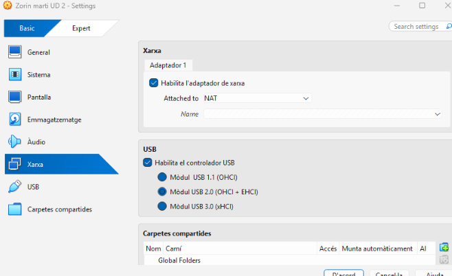

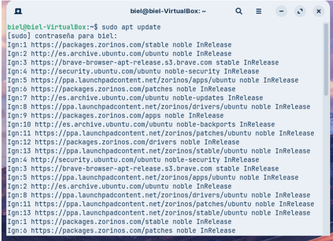

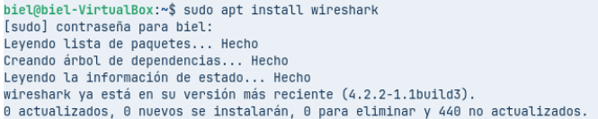

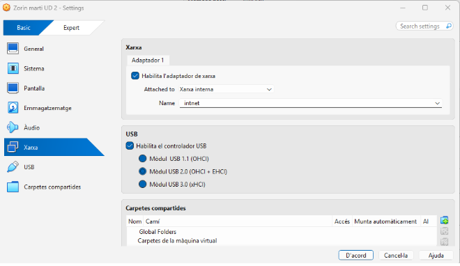

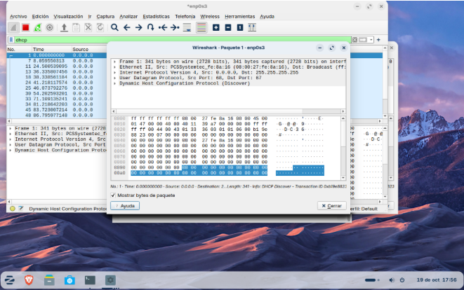

Servidor port 67

Client port 68

* **Quin camp de la capçalera DHCP s'utilitza per identificar unívocament la targeta de xarxa (*NIC*) del client?**

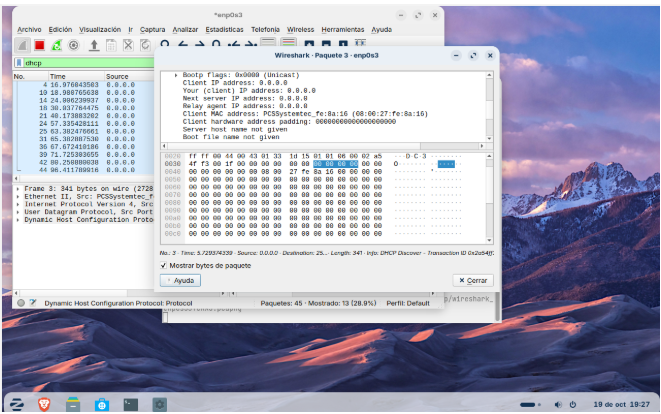

Client Mac address: 00000000000000000000

* **Identifica el número o nom de les Opcions DHCP (*DHCP Options*) encarregades de transmetre la porta d'enllaç per defecte (*Router*), els servidors DNS i el nom de domini.**  
2. 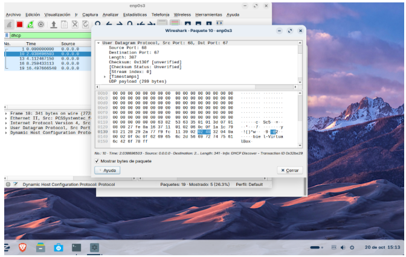
   

Les opcions DHCP són dades que el servidor envia al client, a part de la IP, dins dels missatges Offer i ACK. La porta d’enllaç per defecte (router) es transmet amb l’opció 3, els servidors DNS amb l’opció 6 i el nom de domini amb l’opció 15\. 

##### **Bloc 2: Configuració del Servidor Kea DHCP (kea-dhcp4.conf)**

**Redacta l'estructura del fitxer de configuració JSON per al dimoni kea-dhcp4 complint els requisits següents:**

1. **Interfície i Emmagatzematge:**  
   * **Configuració de la interfície de xarxa eth0.**

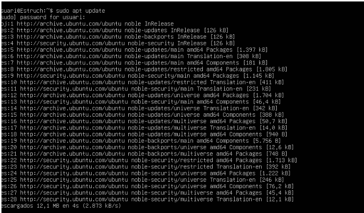
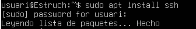
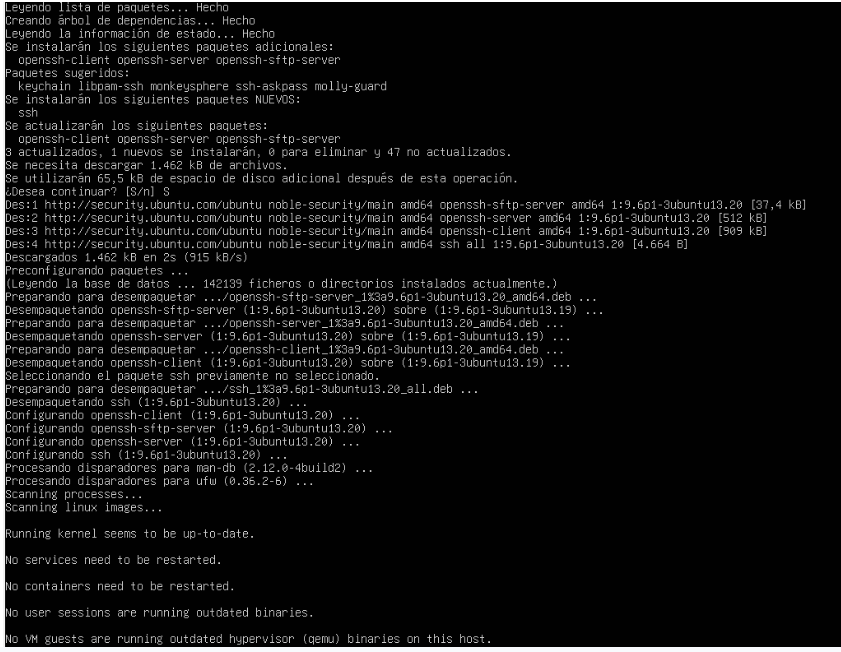
 En l’Ubuntu he instal·lat ssh

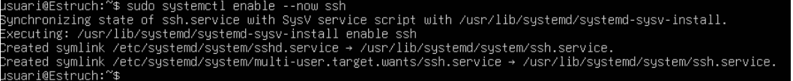

Activo el servei

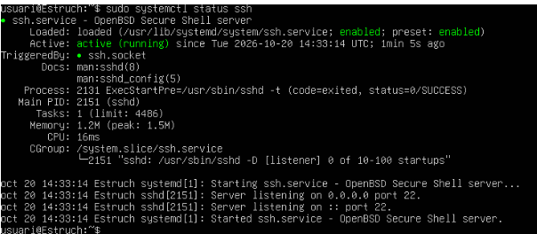

Compruebo que está funcionan

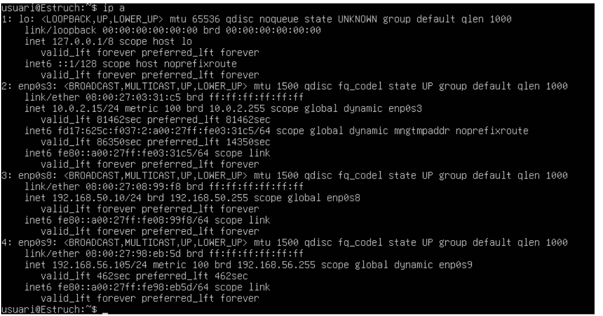

busco la ip

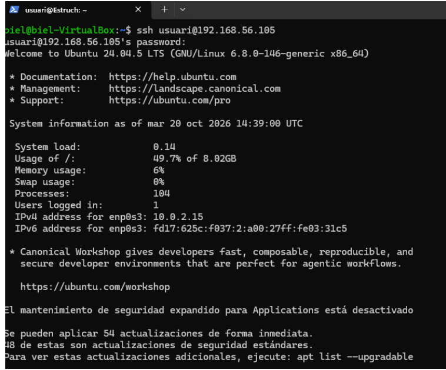

Ho cenecto amb la terminal del meu pc

Entro a Kea 

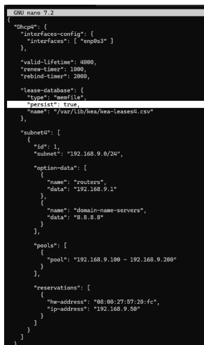

Copio i pego la configuració y poso el meu numero de llista on les x

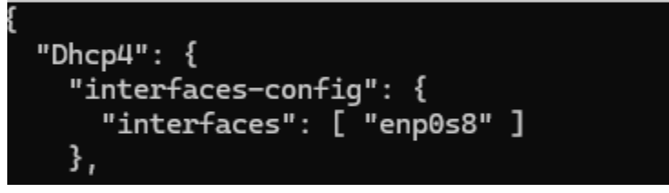

poso la interfície correcte del meu ubuntu

* **Model de base de dades de cessions en memòria (memfile) amb persistència activada.**  
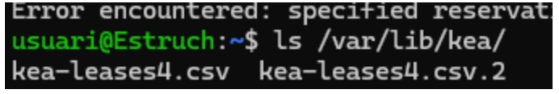
    confirma que el model memfile amb persistència activada guarda les cessions en un fitxer del disc.   
2. **Paràmetres Globals i de Temps:**  
   * **Temps de cessió (*valid-lifetime*): 2 hores (7200 segons).**  
   * **Temps de renovació (*renew-timer*): 1 hora (3600 segons).**  
     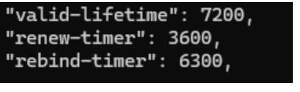  
3. **Subxarxa i Pool Dinàmic:**  
 **Adreça de xarxa: 192.168.x.0/24.**

   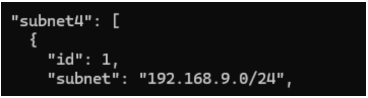

   * A subnet4 he definit la subxarxa 192.168.9.0/24  
       
   * **Rang d'adreces dinàmiques assignables (*pool*): Des de la 192.168.x.50 fins a la 192.168.x.200.**  
       
   * 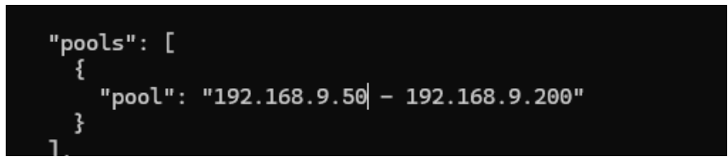
     Y tambe he definit el pool de la 192.168.9.50 a la 192.168.9.200  
   *   
4. **Opcions de Xarxa (*option-data*):**  
   * **Encaminador / Porta d'enllaç: 192.168.x.1.**  
     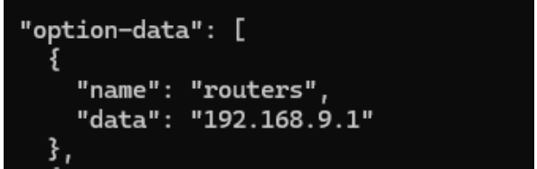
     He definit la porta d'enllaç  
   * **Servidors DNS primari i secundari: 1.1.1.1 i 8.8.8.8.**  
  
     Modifico el Servidor DNS tal com diu el enunciat  
   * **Nom de domini local: oficina.local.**

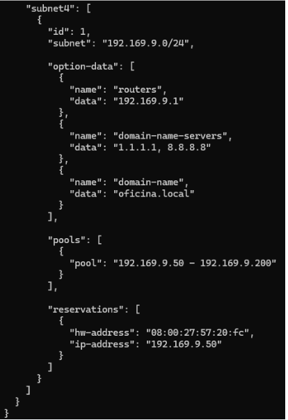

He afegit un "name": "domain-name" , i un "data": "oficina.local" dins de "option-data":

I he posat totes la red ha publica com em vas dir a clase

**Bloc 3: Assignació Estàtica (Reserves per Adreça MAC)**

**Afegeix la secció de reserves (reservations) dins de la configuració de la subxarxa per garantir una adreça IP fixa a una impressora de xarxa de l'oficina:**

**Paràmetres de la reserva:**

**Adreça MAC de la targeta (hw-address): aa:bb:cc:11:22:33.**

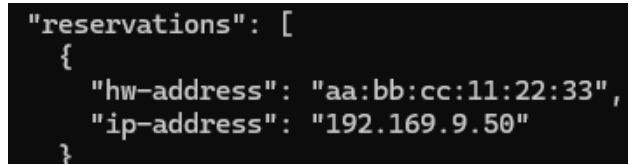

He canviat l'adreça MAC de la tarjeta com m’indica al enunciat

**Adreça IP assignada: 192.168.x.20.**

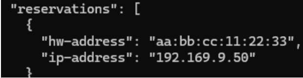

He posat 192.169.9.50 per ficarl-la publica com em vas dir a clase

**Nom de l'equip (hostname): impresora-dir.**

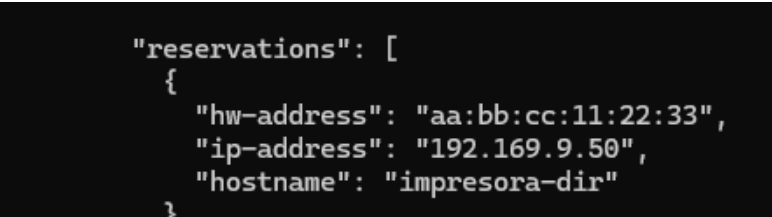

He afegit "hostname": "impresora-dir" per posar nom a l’equip

**Validació de Sintaxi:**

**Indica quines eines o comandes utilitza Kea o el sistema per comprovar que el fitxer JSON no conté errors de sintaxi abans d'iniciar el servei.** 

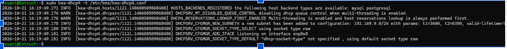

##### **Bloc 4: Comprovació, Diagnòstic i Resolució d'Incidències**

* **Comprovacions al Servidor:**

* **Quines comandes de systemctl permeten verificar l'estat, reiniciar o aturar el servei de Kea DHCP?**

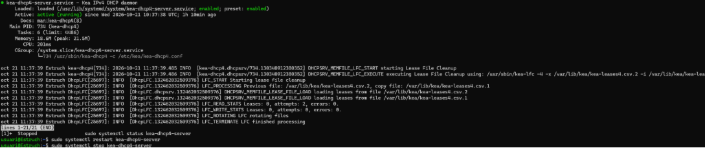

Sudo systemctl status kea-dhcp4-server serveix per veure l'estat del servei 

sudo systemctl restart kea-dhcp4-server serveix per reiniciar

Sudo systemctl stop kea-dhcp4-server serveix per aturar el servei

* **Mitjançant quines comandes o utilitats del sistema (journalctl / registres) es poden consultar les peticions i incidències del servei Kea?**

Aquesta comanda mostra els registres del servei Kea DHCP, i serveix per comprovar que funciona correctament i per trobar errors o veure les peticions dels clients. 

* **En quina ruta i quin fitxer emmagatzema Kea la llista de cessions actives (*leases*) quan s'utilitza el motor memfile?**

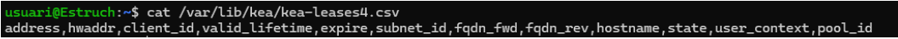

La ruta es /var/lib/kea/ y el fitxer es kea-leases4.csv

**Proves des del Client:**

* **Especifica les comandes necessàries en un client Linux (dhclient / nmcli / ip) per alliberar la IP actual i sol·licitar-ne una de nova.**

sudo dhclient \-r enp0s3 serveix per allibera la IP actual 

Sudo dhclient enp0s3 serveix per sol·licita una IP nova 

sudo nmcli device disconnect enp0s3 serveix per desconnecta la interfície i allibera la IP 

sudo nmcli device connect enp0s3 serveix per reconnecta i demana una IP nova 

Sudo ip addr flush dev enp0s3 serveix per elimina les adreces IP de la interfície 

**Especifica les comandes equivalents en un client Windows (ipconfig).** 

ipconfig /release allibera serveix per l’adreça IP actual 

ipconfig /renew sol·licita serveix per una IP nova al servidor DHCP 

**Bloc 5: Disseny del Mapa Conceptual del Servei DHCP**

**Dibuixa o esquematitza un mapa conceptual que connecti visualment tots els components del servei. En el mapa han d'aparèixer obligatòriament els següents conceptes i relacions (sense incloure la seva definició o explicació):**

**Nivell de Transport i Protocols: Ports UDP (67 i 68), Broadcast vs. Unicast.**

**Cicle de Vida DHCP: Fases DORA (Discover, Offer, Request, Acknowledge).**

**Fitxer de Configuració Kea (kea-dhcp4.conf): Paràmetres interfaces-config, lease-database, valid-lifetime, renew-timer, subnet4, pools, option-data i reservations.**

**Identificació de Dispositius: Adreça MAC (hw-address) i Nom d'host (hostname).**

**Fitxers de Registre i Gestió: Cessions actives (kea-leases4.csv), dimoni de sistema (kea-dhcp4-server) i registre de logs (journalctl).**

**Diagnòstic de Xarxa: Captura de paquets (tcpdump / Wireshark) i comandes de client (ipconfig / dhclient).** 

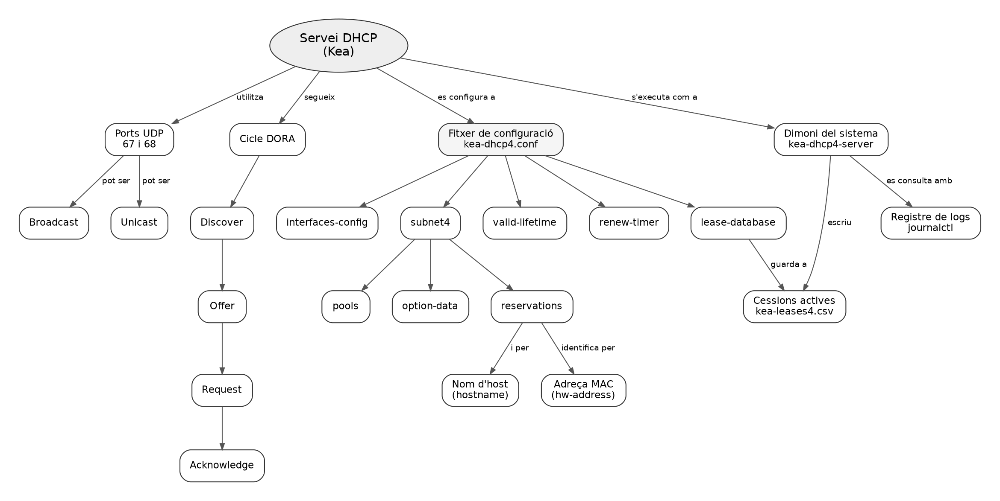